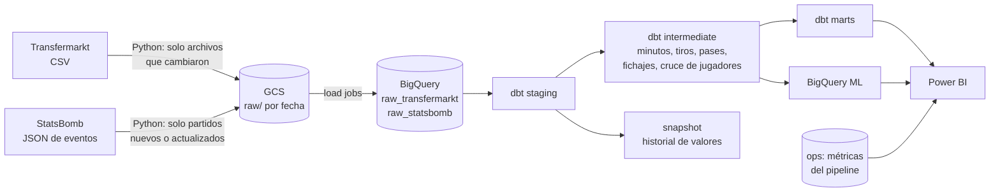
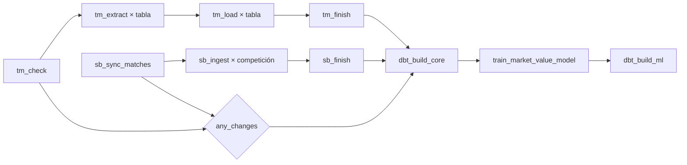
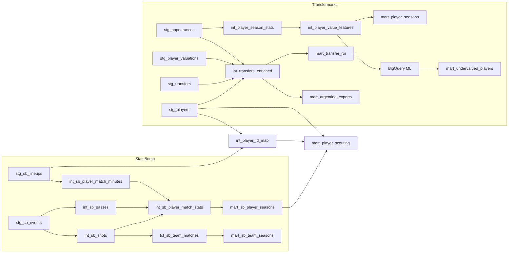

# ⚽ Fuchibol

[](https://github.com/martinix584/fuchibol/actions/workflows/ci.yml)

Pipeline de datos de fútbol de punta a punta: **Python → GCS → BigQuery → dbt → BigQuery ML → Airflow → Power BI**,
con dos fuentes públicas:

- **Transfermarkt** ([transfermarkt-datasets](https://github.com/dcaribou/transfermarkt-datasets), CC0): más de 50.000
  jugadores, 1,9 millones de apariciones, 650.000 valuaciones y 175.000 transferencias.
- **StatsBomb Open Data** ([open-data](https://github.com/statsbomb/open-data)): **datos de eventos del mismo tipo que
  Opta**, es decir cada pase, tiro, conducción y presión con coordenadas y xG. Mundiales, Euros, Copa América, las 5
  grandes ligas 2015/16, la Bundesliga invicta del Leverkusen y todo Messi en La Liga.

> **¿Y Opta?** Opta (Stats Perform) es un producto pago y su licencia no permite publicarlo en un repo. StatsBomb Open
> Data es el equivalente gratuito y abierto que usa la comunidad de análisis: mismo tipo de datos y mismo nivel de
> detalle. FBref muestra datos de Opta, pero sus términos prohíben el scraping.

## Qué responde

| Pregunta | Fuente | Modelo |
|---|---|---|
| **¿Valió lo que se pagó?** Cada fichaje contra lo que pasó después: minutos, goles y asistencias cada 90 y cuánto valía el jugador un año más tarde | Transfermarkt | `mart_transfer_roi`, `mart_club_transfer_balance` |
| **Argentina, fábrica de jugadores.** A dónde se van los argentinos que vende la liga local y cuánto se revalorizan | Transfermarkt | `mart_argentina_exports` |
| **¿Quién está subvaluado?** BigQuery ML estima cuánto "debería" valer cada jugador por su rendimiento | Transfermarkt | `mart_undervalued_players` |
| **¿Quién genera más de lo que muestra?** xG, xA, pases y conducciones progresivas, presiones, todo cada 90 | StatsBomb | `mart_sb_player_seasons`, `fct_sb_shots` |
| **¿Quién tuvo suerte?** Tabla real contra tabla por puntos esperados (xPts) | StatsBomb | `mart_sb_team_seasons` |
| **¿Cuánto cuesta un xG?** Rendimiento de eventos + valor de mercado del mismo jugador | las dos, cruzadas | `mart_player_scouting` |

Y la ficha de cada jugador: partidos, goles, asistencias, goles por partido y cada 90, por temporada y en la carrera.

<p align="center">
  
  
</p>

<sub>Generados por el propio pipeline con datos reales del Mundial 2022 (`make charts`).</sub>

## Arquitectura



**DAG de Airflow** (lunes 06:00 UTC):



- Las dos fuentes corren en paralelo, con tareas mapeadas (una por tabla o por competición-temporada).
- Si ninguna cambió, `any_changes` corta el DAG y no se gasta nada en BigQuery. Si cambió una sola, la otra
  rama queda en *skipped* y dbt corre igual (`trigger_rule="none_failed"`).
- Los manifests (qué ya se procesó) se guardan recién cuando la carga terminó: un reintento nunca saltea datos.

## Modelo de datos (dbt)

37 modelos en 4 capas, 2 seeds, 1 snapshot, 118 data tests, 4 unit tests y 1 exposure (el reporte).



Lo que tiene de interesante cada parte:

- **Minutos jugados de verdad** (`int_sb_player_match_minutes`): parte los tramos de cada jugador en cada tiempo
  usando el inicio y el fin reales (descuento incluido) y une los intervalos superpuestos (*gaps and islands*),
  porque el origen a veces repite tramos.
- **Métricas de scouting** (`int_sb_passes`, `int_sb_player_match_stats`): npxG, xA (el xG de los tiros que generó
  cada pase), pases y conducciones progresivas, pases al área, presiones, quites, intercepciones y más. Todas con
  criterios explícitos y documentados.
- **xPts** (`fct_sb_team_matches`): con el xG de cada equipo como media de una Poisson, calcula la probabilidad de
  cada marcador de 0-0 a 15-15 y de ahí los puntos esperados. Lo cubre un unit test con el resultado calculado aparte.
- **Cruce de identidades** (`int_player_id_map`): StatsBomb y Transfermarkt no comparten ids. Lo resuelven reglas
  de más estricta a menos estricta (nombre + nacionalidad, nombre completo, palabras contenidas, solo nombre) que
  descartan los casos ambiguos en vez de cruzarlos mal, más un seed de cruces manuales.
- **Veredicto de cada fichaje** (`mart_transfer_roi`): reglas simples y explícitas, cubiertas por un unit test.
- **Modelo de BigQuery ML**: un *boosted tree* que aprende el valor de mercado de temporadas pasadas y predice la
  última, que no vio al entrenar. Las variables están definidas una sola vez en `macros/ml.sql`.

## Validación con datos reales

Sin cuenta de GCP no se puede correr BigQuery, así que el repo trae un **smoke test**: compila dbt, traduce el SQL
de BigQuery a DuckDB (con [sqlglot](https://github.com/tobymao/sqlglot)) y corre todos los modelos y data tests
sobre **partidos reales de StatsBomb** y un Transfermarkt sintético. En CI corre con los últimos 8 partidos del
Mundial 2022; localmente, con el torneo completo (`make smoke`):

| Métrica (Mundial 2022 completo, DuckDB local) | Valor |
|---|---|
| Partidos / eventos cargados | 64 / 234.637 |
| Pases / tiros / jugador-partido | 68.515 / 1.453 / 1.995 |
| Data tests que pasan | **114 de 114** (los 4 restantes dependen de BigQuery ML o del snapshot) |
| Duración total (carga + 33 modelos + tests) | 38 s |

Los resultados coinciden con lo que pasó en la cancha:

| Control | Esperado | Pipeline |
|---|---|---|
| Goles del torneo | 172 | 169 de tiros + 3 en contra ✅ |
| Messi: goles / de penal / asistencias | 7 / 4 / 3 | 7 / 4 / 3 ✅ |
| Mbappé: goles / de penal | 8 / 2 | 8 / 2 ✅ |
| Minutos de un titular en la final (120' + 21' de descuento) | ~141 | 141,4 ✅ |

El smoke test encontró cuatro errores reales antes de llegar a BigQuery: una variable de dbt que no se renderizaba
en el nombre del dataset de origen, una columna ambigua en un join, una macro `per_90` sin paréntesis
(`npxg + xa * 90`) y minutos duplicados por tramos superpuestos en el origen.

## Métricas del pipeline en BigQuery

Cada corrida guarda filas, bytes y tiempos por tabla en `ops.pipeline_runs`, y el resultado de cada modelo y test
de dbt en `ops.dbt_results`. `make metrics` las imprime listas para pegar acá:

| Métrica | Valor |
|---|---|
| Filas cargadas por fuente | _pendiente de la primera corrida en GCP_ |
| Volumen en GCS y BigQuery | _pendiente_ |
| Duración del DAG y de `dbt build` | _pendiente_ |
| Tests que pasan | _pendiente_ |
| Jugadores cruzados entre fuentes, por regla | _pendiente_ |
| Modelo ML: R² / MAE (log del valor) | _pendiente_ |
| Costo mensual | _pendiente_ (diseñado para entrar en el nivel gratuito) |

## Calidad

| Qué | Dónde | Cuándo |
|---|---|---|
| Lint y formato (ruff) | `ingestion/`, `dags/`, `tests/`, `scripts/` | CI |
| 22 tests unitarios de Python (plan incremental, manifests, esquemas, métricas) | `tests/` | CI |
| `dbt parse` (SQL, refs, YAML) | `dbt/` | CI |
| Smoke test de punta a punta con partidos reales | `tests/smoke/` | CI |
| `dag.test()` del DAG en 4 escenarios (las dos fuentes, una, la otra, ninguna) | `tests/dags/` | CI |
| 118 data tests de dbt (genéricos, propios y de negocio) | `dbt/` | cada `dbt build` |
| 4 unit tests de dbt (minutos, xPts, veredicto de fichajes) | `dbt/models/**/_*.yml` | cada `dbt build` |

## Decisiones de diseño

- **Incremental donde importa.** Transfermarkt publica fotos completas: se compara la huella (ETag) de cada archivo.
  StatsBomb publica por partido: se compara el `last_updated` de cada uno. Se baja solo lo nuevo.
- **Raw *append-only* + deduplicación en staging.** Los eventos se agregan con cada ingesta y `stg_sb_events` se
  queda con la última de cada partido. Reprocesar nunca duplica, y el raw guarda la historia.
- **Esquema explícito al cargar.** El JSON de StatsBomb trae decenas de campos anidados: se carga con un esquema
  propio (`ingestion/schemas/`) e `ignore_unknown_values`. En GCS queda el JSON completo por si mañana hace falta
  otro campo.
- **Load jobs, no streaming.** Los load jobs de BigQuery son gratis; los streaming inserts no.
- **Freno de costos.** `maximum_bytes_billed` en el profile de dbt; tablas grandes particionadas y clusterizadas.
- **Historial propio con snapshots.** `snap_players` (SCD tipo 2) guarda cada cambio de valor, club o contrato.
- **Sin paquetes externos de dbt.** Tests genéricos propios (`non_negative`, `in_range`, `unique_combination`,
  `outcome_probabilities_sum_to_one`).

## Sobre los datos (leer antes de sacar conclusiones)

- **StatsBomb:** datos de [StatsBomb Open Data](https://github.com/statsbomb/open-data). Sus términos piden citarlos
  como fuente y usar su logo en lo que se publique. Coordenadas en una cancha de 120 × 80 con el ataque siempre
  hacia la derecha. El open data cubre torneos y temporadas puntuales, no ligas enteras actuales; en las ligas de
  Messi solo están los partidos del Barcelona.
- **Transfermarkt:** los valores de mercado son **estimaciones** de su comunidad, no precios. `transfer_fee = 0`
  mezcla pases libres y préstamos; `null` es desconocido. Según el proyecto, **los datos llegan hasta el 6 de julio
  de 2026** y las actualizaciones están pausadas: el DAG lo detecta y no reprocesa nada hasta que vuelvan.
- Las métricas cada 90 de jugadores con pocos minutos no son confiables: filtrá por minutos.
- Simplificación: las temporadas de Transfermarkt se cierran el 30 de junio; en ligas de calendario anual (como la
  argentina) eso corre la ventana medio año.

## Cómo correrlo

### Sin GCP (en 2 minutos)

```bash
make setup && source .venv/bin/activate
make smoke          # dbt de punta a punta en DuckDB con el Mundial 2022 real
make charts         # regenera los gráficos del README
```

### Con GCP

```bash
gcloud config set project <tu-proyecto>      # con facturación activa
gcloud services enable bigquery.googleapis.com storage.googleapis.com
gcloud storage buckets create gs://<tu-bucket> --location=US

# Service account para Airflow
gcloud iam service-accounts create fuchibol-pipeline
SA=fuchibol-pipeline@<tu-proyecto>.iam.gserviceaccount.com
gcloud projects add-iam-policy-binding <tu-proyecto> --member=serviceAccount:$SA --role=roles/bigquery.dataEditor
gcloud projects add-iam-policy-binding <tu-proyecto> --member=serviceAccount:$SA --role=roles/bigquery.jobUser
gcloud storage buckets add-iam-policy-binding gs://<tu-bucket> --member=serviceAccount:$SA --role=roles/storage.objectAdmin
mkdir -p keys && gcloud iam service-accounts keys create keys/sa.json --iam-account=$SA

cp .env.example .env && set -a && source .env && set +a     # completá proyecto y bucket
gcloud auth application-default login

make extract        # primera carga de las dos fuentes (STATSBOMB_SCOPE=core: ~350 partidos)
make dbt-build      # seeds, modelos, snapshot, data tests y unit tests
make dbt-train      # BigQuery ML
make dbt-docs       # documentación y linaje en http://localhost:8081
make airflow-up     # Airflow en http://localhost:8080
```

> El **sandbox** de BigQuery (sin tarjeta) no alcanza: no permite `MERGE`, que usan los snapshots. Con la
> facturación activa, el alcance `core` entra en el nivel gratuito (10 GB de almacenamiento y 1 TB de consultas por
> mes). Configurá igual una **alerta de presupuesto**. Los alcances `big5_2015`, `messi` o `all` suman varios GB.

Para reprocesar todo desde Airflow: *Trigger DAG w/ config* → `{"force": true}`. Para cambiar el alcance de
StatsBomb en una corrida: `{"statsbomb_scope": "core,big5_2015"}`.

## Estructura

```
├── dags/fuchibol_pipeline.py        # DAG de Airflow 3 (dos ramas + dbt + ML)
├── ingestion/
│   ├── extract.py, load.py          # Transfermarkt
│   ├── statsbomb.py                 # StatsBomb (plan incremental, eventos y alineaciones)
│   ├── schemas/                     # esquemas de BigQuery para el JSON de StatsBomb
│   ├── metrics.py, storage.py, config.py
├── dbt/
│   ├── models/{staging,intermediate,marts,ml}/{transfermarkt,statsbomb}
│   ├── seeds/                       # alias de países y cruces manuales de jugadores
│   ├── snapshots/  macros/  tests/
├── tests/
│   ├── test_*.py                    # pytest
│   ├── smoke/                       # dbt en DuckDB con datos reales
│   └── dags/                        # escenarios del DAG
├── powerbi/                         # guía del reporte y tema
├── scripts/                         # ingesta manual, smoke, test del DAG, métricas, gráficos
├── docs/img/                        # gráficos del README
├── docker/ + docker-compose.yml     # Airflow local
└── .github/workflows/ci.yml         # lint, pytest, dbt parse, smoke y DAG
```

## Próximos pasos

- [ ] Primera corrida en GCP y completar la tabla de métricas.
- [ ] Armar el reporte de Power BI (guía en [`powerbi/`](powerbi/README.md)) y subir capturas y un GIF.
- [ ] Publicar los docs de dbt en GitHub Pages.
- [ ] Sumar los datos 360 de StatsBomb (posición de todos los jugadores en cada evento) para métricas de presión.

---

<sub>Datos de eventos: [StatsBomb Open Data](https://github.com/statsbomb/open-data).
Datos de mercado: [transfermarkt-datasets](https://github.com/dcaribou/transfermarkt-datasets), a partir de Transfermarkt.</sub>

<a href="https://github.com/statsbomb/open-data"></a>
