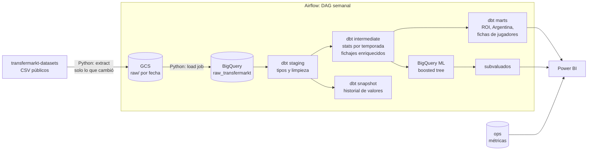
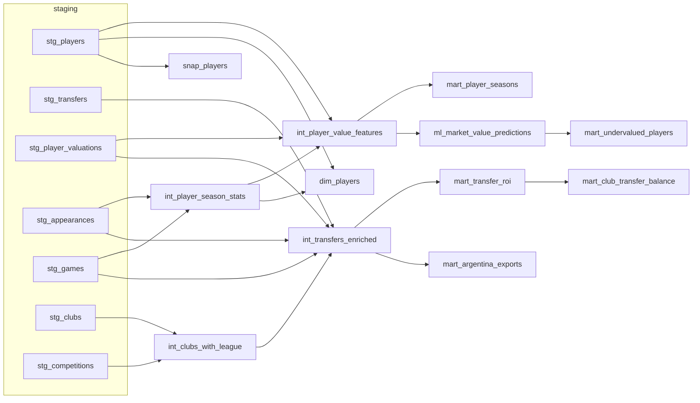

# ⚽ Fuchibol: ¿valió lo que se pagó?

Pipeline de datos de punta a punta sobre el mercado de pases del fútbol: **Python → GCS → BigQuery → dbt → BigQuery ML → Airflow → Power BI**.

Usa datos reales de más de 50.000 jugadores, 1,9 millones de apariciones, 650.000 valuaciones y 175.000 transferencias para responder tres preguntas:

1. **¿Valió lo que se pagó?** Cada fichaje comparado con lo que pasó después: minutos jugados, goles y asistencias cada 90 y cuánto valía el jugador un año más tarde. Ranking de clubes que compran bien y que compran mal.
2. **Argentina, fábrica de jugadores.** A dónde se van los argentinos que vende la liga local, qué clubes venden más y cuánto se revalorizan afuera.
3. **¿Quién está subvaluado?** Un modelo de BigQuery ML estima cuánto "debería" valer cada jugador según su rendimiento y su perfil, y lo compara con su valor de mercado.

Además, cada jugador tiene su ficha con partidos, goles, asistencias, goles por partido y cada 90, por temporada y en toda la carrera.

## Arquitectura



| Paso | Herramienta | Qué hace |
|---|---|---|
| Extract | Python (`ingestion/extract.py`) | Compara la huella (ETag) de cada CSV con un manifest en GCS y baja **solo lo que cambió** a `gs://<bucket>/raw/transfermarkt/<tabla>/ingest_date=<fecha>/` |
| Load | Python (`ingestion/load.py`) | Load jobs de BigQuery (gratis) a `raw_transfermarkt` |
| Transform | dbt (`dbt/`) | staging → intermediate → marts, snapshot SCD2 y tests |
| ML | BigQuery ML desde dbt | `run-operation train_market_value_model` + modelos `tag:ml` |
| Orquestación | Airflow 3 (`dags/`) | DAG semanal con tareas mapeadas por tabla; si no cambió nada, corta temprano y no gasta |
| Métricas | `ingestion/metrics.py` | Filas, bytes, tiempos y resultados de tests a `ops.pipeline_runs` y `ops.dbt_results` |
| Reporte | Power BI (`powerbi/`) | 5 páginas, ver [powerbi/README.md](powerbi/README.md) |

### Linaje de dbt



## Métricas

> Se completan con `make metrics`, que lee las tablas `ops.*` de la última corrida.

| Métrica | Valor |
|---|---|
| Filas cargadas (7 tablas) | _pendiente_ |
| Volumen descargado | _pendiente_ |
| Modelos dbt | 21 (7 staging, 4 intermediate, 6 marts, 4 ML) + 1 snapshot |
| Tests de dbt | 67 (genéricos, propios y singulares) |
| Tests que pasan | _pendiente_ |
| Duración del DAG completo | _pendiente_ |
| Duración de `dbt build` | _pendiente_ |
| Modelo ML: R² / MAE (log del valor) | _pendiente_ |
| Costo mensual en GCP | _pendiente_ (diseñado para entrar en el nivel gratuito) |

## Decisiones de diseño

- **Incremental a nivel archivo.** El origen publica fotos completas, así que no tiene sentido hacer upserts fila por fila. El DAG compara huellas y, si nada cambió, se corta en la primera tarea (short-circuit).
- **Historial propio con snapshots.** `snap_players` (SCD tipo 2) guarda cada cambio de valor de mercado, club o contrato, así que cada corrida semanal suma historia aunque el origen solo traiga el valor actual.
- **Load jobs, no streaming.** Los load jobs de BigQuery son gratis; los streaming inserts no.
- **Freno de costos.** `maximum_bytes_billed` en el profile de dbt; las marts están particionadas y clusterizadas.
- **Tests sin paquetes externos.** Tests genéricos propios (`non_negative`, `in_range`, `unique_combination`) y tests singulares de negocio, por ejemplo que nadie promedie más de 2 goles cada 90 con 900 minutos o más.
- **ML sin salir de SQL.** BigQuery ML entrena con temporadas pasadas y predice la última, que el modelo no vio al entrenar. Las variables están definidas una sola vez en `macros/ml.sql`.
- **Umbrales explícitos.** El veredicto de cada fichaje (Acierto / Cumplió / Fracaso) usa reglas simples y documentadas en `mart_transfer_roi.sql`, a propósito: se pueden discutir y ajustar.

## Sobre los datos (leer antes de sacar conclusiones)

- Fuente: [transfermarkt-datasets](https://github.com/dcaribou/transfermarkt-datasets) (licencia **CC0**), construido a partir de Transfermarkt. No se scrapea nada: se usan los archivos ya publicados.
- Los **valores de mercado son estimaciones** de la comunidad de Transfermarkt, no precios reales.
- `transfer_fee = 0` mezcla pases libres y préstamos; `null` es monto desconocido. Por eso el análisis de ROI usa solo fichajes con monto pagado.
- Cobertura: las estadísticas solo existen para las competiciones que cubre el dataset (las ligas principales de Europa, Argentina, Brasil, copas internacionales y torneos de selecciones).
- **Actualizaciones pausadas:** según el propio proyecto, los datos llegan hasta el **6 de julio de 2026** y no hay fecha de reanudación. El pipeline lo maneja sin problemas: si los archivos no cambian, el DAG no reprocesa nada; cuando el origen vuelva a actualizarse, las corridas semanales retoman solas.
- Simplificación: las temporadas se cierran el 30 de junio (calendario europeo); en ligas de calendario anual, como la argentina, eso corre la ventana medio año.

## Cómo correrlo

### 1. GCP (una sola vez)

```bash
gcloud projects create <tu-proyecto>      # o usá uno existente, con facturación activa
gcloud config set project <tu-proyecto>
gcloud services enable bigquery.googleapis.com storage.googleapis.com
gcloud storage buckets create gs://<tu-bucket> --location=US

# Service account para Airflow
gcloud iam service-accounts create fuchibol-pipeline
SA=fuchibol-pipeline@<tu-proyecto>.iam.gserviceaccount.com
gcloud projects add-iam-policy-binding <tu-proyecto> --member=serviceAccount:$SA --role=roles/bigquery.dataEditor
gcloud projects add-iam-policy-binding <tu-proyecto> --member=serviceAccount:$SA --role=roles/bigquery.jobUser
gcloud storage buckets add-iam-policy-binding gs://<tu-bucket> --member=serviceAccount:$SA --role=roles/storage.objectAdmin
mkdir -p keys && gcloud iam service-accounts keys create keys/sa.json --iam-account=$SA
```

> El **sandbox** de BigQuery (sin tarjeta) no sirve: no permite `MERGE`, que usan los snapshots de dbt. Con la facturación activa, este volumen entra en el nivel gratuito (10 GB de almacenamiento y 1 TB de consultas por mes). Configurá igual una **alerta de presupuesto**.

### 2. Local

```bash
cp .env.example .env          # completá proyecto y bucket
make setup && source .venv/bin/activate
set -a && source .env && set +a
gcloud auth application-default login

make extract                  # primera carga: GCS + BigQuery
make dbt-build                # modelos + snapshot + tests
make dbt-train                # BigQuery ML
make dbt-docs                 # documentación y linaje en http://localhost:8081
```

### 3. Airflow

```bash
make airflow-up               # http://localhost:8080 → DAG "fuchibol_pipeline"
```

Corre los lunes a las 06:00 UTC. Para reprocesar todo: *Trigger DAG w/ config* → `{"force": true}`.

## Estructura

```
├── dags/fuchibol_pipeline.py     # DAG de Airflow 3
├── ingestion/                    # extract, load y métricas (Python)
├── dbt/
│   ├── models/{staging,intermediate,marts,ml}
│   ├── snapshots/                # historial de valores (SCD2)
│   ├── macros/                   # per_90, BigQuery ML, schemas
│   └── tests/                    # tests genéricos y singulares
├── powerbi/                      # .pbix, capturas y guía del reporte
├── scripts/                      # ingesta manual y reporte de métricas
├── tests/                        # pytest
├── docker/ + docker-compose.yml  # Airflow local
└── .github/workflows/ci.yml      # lint + pytest + dbt parse
```

## Próximos pasos

- [ ] Primera carga real y completar la tabla de métricas.
- [ ] Armar el `.pbix` y subir capturas y un GIF.
- [ ] Publicar los docs de dbt en GitHub Pages.
- [ ] Sumar xG de [StatsBomb Open Data](https://github.com/statsbomb/open-data) para los torneos que cubre.
