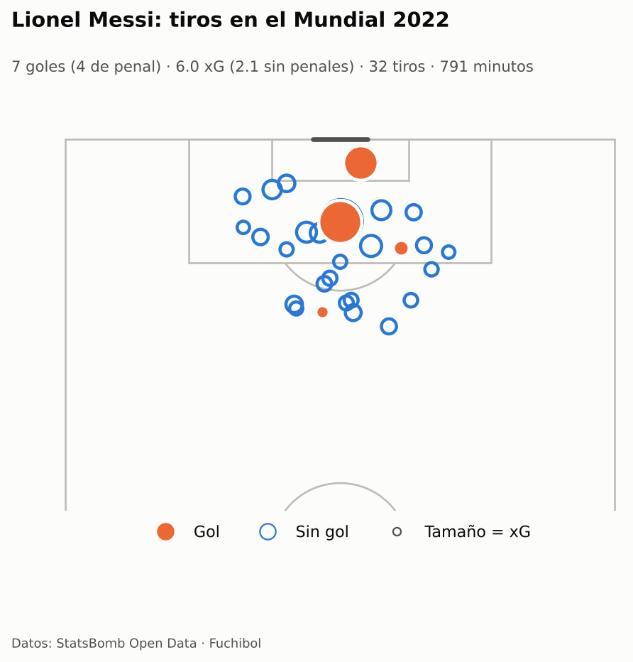
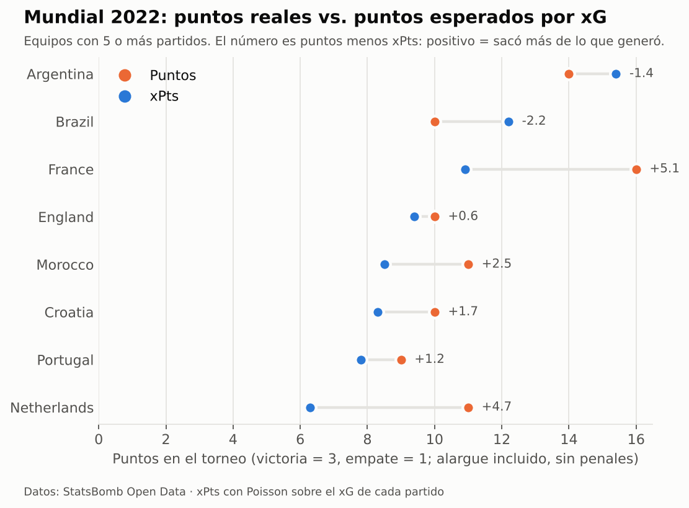
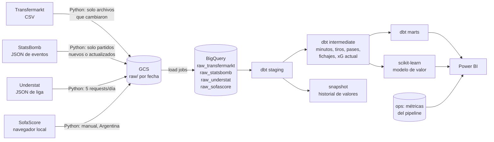
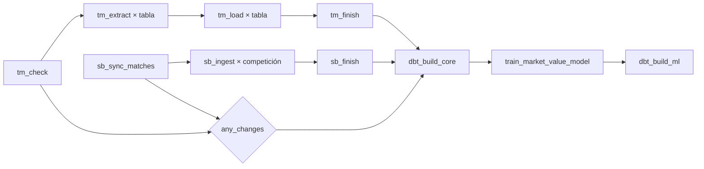
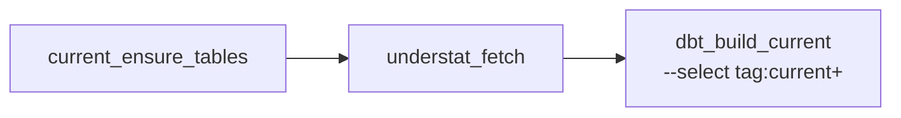
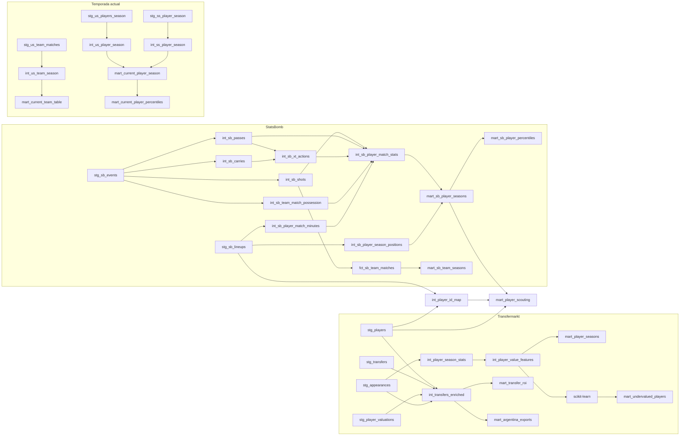

# ⚽ Fuchibol

[](https://github.com/martinix584/fuchibol/actions/workflows/ci.yml)

**App:** <https://fuchibol-jqccimrmzhgzszr5ihoymg.streamlit.app/> (radar de jugadores, subvaluados, fichajes y mapa de tiros)

Pipeline de datos de fútbol de punta a punta: **Python → GCS → BigQuery → dbt → scikit-learn → Airflow → Power BI**,
con cuatro fuentes:

- **Transfermarkt** ([transfermarkt-datasets](https://github.com/dcaribou/transfermarkt-datasets), CC0): más de 50.000
  jugadores, 1,9 millones de apariciones, 650.000 valuaciones y 175.000 transferencias.
- **StatsBomb Open Data** ([open-data](https://github.com/statsbomb/open-data)): **datos de eventos del mismo tipo que
  Opta**, es decir cada pase, tiro, conducción y presión con coordenadas y xG. Mundiales, Euros, Copa América, las 5
  grandes ligas 2015/16 (cuatro completas), la Bundesliga invicta del Leverkusen y todo Messi en La Liga.
- **Understat** ([understat.com](https://understat.com)): xG, xA, npxG, xGChain y xGBuildup de la **temporada actual**
  de las 5 grandes ligas. Corre a diario en Airflow.
- **SofaScore** ([sofascore.com](https://www.sofascore.com)): xG/xA de la **Liga Profesional Argentina** y respaldo
  manual de las 5 grandes. Es opcional y se corre **localmente** con Playwright: no va en Airflow.

## Qué responde

| Pregunta | Fuente | Modelo |
|---|---|---|
| **¿Valió lo que se pagó?** Cada fichaje contra lo que pasó después: minutos, goles y asistencias cada 90 y cuánto valía el jugador un año más tarde | Transfermarkt | `mart_transfer_roi`, `mart_club_transfer_balance` |
| **Argentina, fábrica de jugadores.** A dónde se van los argentinos que vende la liga local y cuánto se revalorizan | Transfermarkt | `mart_argentina_exports` |
| **¿Quién está subvaluado?** Un modelo de ML estima cuánto "debería" valer cada jugador por su rendimiento | Transfermarkt | `mart_undervalued_players` |
| **¿Quién genera más de lo que muestra?** xG, xA, pases y conducciones progresivas, presiones, todo cada 90 | StatsBomb | `mart_sb_player_seasons`, `fct_sb_shots` |
| **¿Quién tuvo suerte?** Tabla real contra tabla por puntos esperados (xPts) | StatsBomb | `mart_sb_team_seasons` |
| **¿Quién rinde hoy en las 5 grandes?** xG, xA y npxG de la temporada en curso, con la fuente marcada | Understat | `mart_current_player_season`, `mart_current_team_table` |
| **¿Y la Liga Argentina?** xG/xA de la temporada en curso, sin mezclar modelos de xG | SofaScore | `mart_current_player_season` (`xg_source = 'sofascore'`) |
| **¿Cuánto cuesta un xG?** Rendimiento de eventos + valor de mercado del mismo jugador | las históricas, cruzadas | `mart_player_scouting` |

Y la ficha de cada jugador: partidos, goles, asistencias, goles por partido y cada 90, por temporada y en la carrera.

<p align="center">
  
  
</p>

<sub>Generados por el propio pipeline con datos reales del Mundial 2022 (`make charts`).</sub>

## Arquitectura



**DAG semanal** (lunes 06:00 UTC, Transfermarkt + StatsBomb + histórico):



**DAG diario de la temporada actual** (`fuchibol_current_season`, 07:00 UTC):



- Understat es la fuente automática de xG de las 5 grandes. SofaScore **no** corre en Airflow: se ejecuta localmente y
  sus tablas existen vacías hasta que lo hagas. El DAG diario siempre puede construir los marts.
- Las dos ramas históricas corren en paralelo, con tareas mapeadas (una por tabla o por competición-temporada).
- Si ninguna cambió, `any_changes` corta el DAG semanal y no se gasta nada en BigQuery. Si cambió una sola, la otra
  rama queda en *skipped* y dbt corre igual (`trigger_rule="none_failed"`).
- Los manifests (qué ya se procesó) se guardan recién cuando la carga terminó: un reintento nunca saltea datos.
- El DAG semanal excluye `tag:current`; los marts de la temporada actual los construye el DAG diario.

## Modelo de datos (dbt)

53 modelos en 4 capas, 4 seeds, 1 snapshot, 172 data tests, 5 unit tests y 1 exposure (el reporte).



Lo que tiene de interesante cada parte:

- **Minutos jugados de verdad** (`int_sb_player_match_minutes`): parte los tramos de cada jugador en cada tiempo
  usando el inicio y el fin reales (descuento incluido) y une los intervalos superpuestos (*gaps and islands*),
  porque el origen a veces repite tramos.
- **Métricas de scouting** (`int_sb_passes`, `int_sb_player_match_stats`): npxG, xA (el xG de los tiros que generó
  cada pase), pases y conducciones progresivas, pases al área, presiones, quites, intercepciones y más. Todas con
  criterios explícitos y documentados.
- **xT, Expected Threat** (`int_sb_xt_actions`): cuánto acerca al gol cada pase completado y cada conducción,
  con la grilla pública 12 × 8 de [Karun Singh](https://karun.in/blog/expected-threat.html) cargada como seed.
  Mide a los que mueven la pelota a zonas peligrosas aunque no den el último pase. Lo cubre un unit test.
- **PAdj quites + intercepciones** (`int_sb_team_match_possession`): un defensor de un equipo con poca pelota
  suma más quites solo porque defiende más. Se ajusta con la fórmula sigmoide de
  [StatsBomb](https://blogarchive.statsbomb.com/articles/soccer/introducing-possession-adjusted-player-stats/)
  sobre la posesión del equipo en cada partido.
- **Percentiles por posición** (`mart_sb_player_percentiles`, `mart_current_player_percentiles`): cada métrica cada
  90 contra los del mismo grupo de posición (GK, CB, FB, CM, W/AM, ST, por minutos en cada puesto) en la misma
  competición, con 600 minutos o más. En la temporada actual, por liga y por fuente de xG, sin mezclarlas.
- **xPts** (`fct_sb_team_matches`): con el xG de cada equipo como media de una Poisson, calcula la probabilidad de
  cada marcador de 0-0 a 15-15 y de ahí los puntos esperados. Lo cubre un unit test con el resultado calculado aparte.
- **Cruce de identidades** (`int_player_id_map`): StatsBomb y Transfermarkt no comparten ids. Lo resuelven reglas
  de más estricta a menos estricta (nombre + nacionalidad, nombre completo, palabras contenidas, solo nombre) que
  descartan los casos ambiguos en vez de cruzarlos mal, más un seed de cruces manuales.
- **Veredicto de cada fichaje** (`mart_transfer_roi`): reglas simples y explícitas, cubiertas por un unit test.
- **Modelo de valor de mercado** (`ingestion/ml.py`): un *boosted tree* de scikit-learn que aprende el valor de
  mercado de temporadas pasadas y predice la última, que no vio al entrenar. La idea era BigQuery ML, pero para
  este proyecto no valía la pena: factura cada vuelta del entrenamiento sobre la tabla, y una tabla de 27 MB
  contaba como más de 20 GB. Con scikit-learn se entrena en segundos y gratis, y las predicciones vuelven a
  BigQuery (dataset `ml`) para que dbt arme `mart_undervalued_players`.
- **xG de la temporada actual sin mezclar fuentes** (`mart_current_player_season`): las 5 grandes salen de Understat
  y Argentina de SofaScore. Cada fila lleva `xg_source`; no hay fallback automático entre fuentes porque los modelos
  de xG no son comparables. El respaldo manual se activa con `--vars '{xg_source_big5: sofascore}'`.

## Validación con datos reales

Sin cuenta de GCP no se puede correr BigQuery, así que el repo trae un **smoke test**: compila dbt, traduce el SQL
de BigQuery a DuckDB (con [sqlglot](https://github.com/tobymao/sqlglot)) y corre todos los modelos y data tests
sobre **partidos reales de StatsBomb**, un Transfermarkt sintético y datos sintéticos de Understat/SofaScore.
En CI corre con los últimos 8 partidos del Mundial 2022; localmente, con el torneo completo (`make smoke`):

| Métrica (Mundial 2022 completo, DuckDB local) | Valor |
|---|---|
| Partidos / eventos cargados | 64 / 234.637 |
| Pases / tiros / jugador-partido | 68.515 / 1.453 / 1.995 |
| Data tests que pasan | **166 de 167** y 1 aviso a propósito (un jugador sintético que pateó sin xG); los del modelo de ML o del snapshot no corren en DuckDB |
| Duración total (carga + modelos + tests) | ~36 s |

Los resultados coinciden con lo que pasó en la cancha:

| Control | Esperado | Pipeline |
|---|---|---|
| Goles del torneo | 172 | 169 de tiros + 3 en contra ✅ |
| Messi: goles / de penal / asistencias | 7 / 4 / 3 | 7 / 4 / 3 ✅ |
| Mbappé: goles / de penal | 8 / 2 | 8 / 2 ✅ |
| Minutos de un titular en la final (120' + 21' de descuento) | ~141 | 141,4 ✅ |

El smoke test encontró cuatro errores reales antes de llegar a BigQuery: una variable de dbt que no se renderizaba
en el nombre del dataset de origen, una columna ambigua en un join, una macro `per_90` sin paréntesis
(`npxg + xa * 90`) y minutos duplicados por tramos superpuestos en el origen.

Además se corrió con partidos de otras épocas y competiciones (Mundial 1970, La Liga 2004/05, Premier 2015/16,
Bundesliga 2023/24, Copa Africana 2023, Champions 2018/19): pasan los 152 tests. Eso destapó dos casos más que
ya están resueltos: tramos repetidos de forma idéntica, que con empates podían contar minutos dos veces (ahora lo
cubre un unit test), y coordenadas apenas afuera de la cancha. Aparte, se validaron los tipos del esquema de
BigQuery contra 606.713 eventos reales de las 67 competiciones-temporada masculinas.

## Métricas del pipeline en BigQuery

Cada corrida guarda filas, bytes y tiempos por tabla en `ops.pipeline_runs`, y el resultado de cada modelo y test
de dbt en `ops.dbt_results`. `make metrics` las imprime listas para pegar acá.

Primera carga completa en GCP (22/10/2026): Transfermarkt, StatsBomb (alcance `core`), Understat y SofaScore
Argentina, más el modelo de valor de mercado entrenado en local con scikit-learn. El 23/10/2026 se sumaron
las 5 grandes 2026/27 con SofaScore en modo `full` (2.141 jugadores) para la comparación de modelos de xG.

| Métrica | Valor |
|---|---|
| Filas cargadas por fuente | Transfermarkt: 50.149 jugadores, 1,89 M apariciones, 656.301 valuaciones y 175.165 transferencias. StatsBomb: 348 partidos y 1,24 M eventos. Understat 2026/27: 2.210 jugadores en 5 ligas. SofaScore: 2.980 jugadores (839 de Argentina y 2.141 de las 5 grandes 2026/27) |
| Volumen | 160 MB en GCS y 1,4 GB en BigQuery |
| Duración de `dbt build` (sin ML ni temporada actual) | ~3 min (173 nodos) |
| Carga SofaScore 5 grandes (`full`) | 2.141 jugadores en ~3 h, una liga por proceso y 4 s entre requests |
| Data tests | Build principal: 168 pasan y 4 avisos. Temporada actual: 54 pasan y 1 aviso (los 86 jugadores de SofaScore que patearon sin xG). Ningún error |
| Jugadores cruzados StatsBomb → Transfermarkt | 2.551 de 3.080 (82,8 %): 2.218 nombre + nacionalidad, 167 palabras contenidas, 116 solo nombre, 49 nombre completo, 1 manual |
| Modelo ML: R² / MAE (log del valor) | R² 0,83, MAE 0,46 y error mediano 0,37 sobre 10.072 filas de evaluación (≈ ×1,6 de error típico en el valor). Leyó 54.463 temporadas-jugador y entrenó con 40.285 en 43 s; predice 4.106 jugadores de 2025 |
| Costo mensual | US$0 dentro del free tier: 5,8 GB de queries y ~1,4 GB de storage en BigQuery (límites: 1 TB y 10 GB/mes), ~160 MB en GCS (límite: 5 GB). Alerta de presupuesto a US$1/mes, con avisos al 50 % y al 100 % |

## Calidad

| Qué | Dónde | Cuándo |
|---|---|---|
| Lint y formato (ruff) | `ingestion/`, `dags/`, `tests/`, `scripts/` | CI |
| 75 tests unitarios de Python (plan incremental, manifests, esquemas, métricas, Understat y SofaScore) | `tests/` | CI |
| `dbt parse` (SQL, refs, YAML) | `dbt/` | CI |
| Smoke test de punta a punta con partidos reales | `tests/smoke/` | CI |
| `dag.test()` del DAG en 4 escenarios (las dos fuentes, una, la otra, ninguna) | `tests/dags/` | CI |
| 172 data tests de dbt (genéricos, propios y de negocio) | `dbt/` | cada `dbt build` |
| 5 unit tests de dbt (xPts, xT, minutos, veredicto de fichajes) | `dbt/models/**/_*.yml` | cada `dbt build` |

## Decisiones de diseño

- **Incremental donde importa.** Transfermarkt publica fotos completas: se compara la huella (ETag) de cada archivo.
  StatsBomb publica por partido: se compara el `last_updated` de cada uno. Se baja solo lo nuevo.
- **Raw *append-only* + deduplicación en staging.** Los eventos se agregan con cada ingesta y `stg_sb_events` se
  queda con la última de cada partido. Reprocesar nunca duplica, y el raw guarda la historia.
- **Esquema explícito al cargar.** El JSON de StatsBomb trae decenas de campos anidados: se carga con un esquema
  propio (`ingestion/schemas/`) e `ignore_unknown_values`. En GCS queda el JSON completo por si mañana hace falta
  otro campo.
- **Load jobs, no streaming.** Los load jobs de BigQuery son gratis; los streaming inserts no.
- **Freno de costos.** `maximum_bytes_billed` en el profile de dbt; tablas grandes particionadas y clusterizadas.
- **Historial propio con snapshots.** `snap_players` (SCD tipo 2) guarda cada cambio de valor, club o contrato.
- **Sin paquetes externos de dbt.** Tests genéricos propios (`non_negative`, `in_range`, `unique_combination`,
  `outcome_probabilities_sum_to_one`).

## Sobre los datos (leer antes de sacar conclusiones)

- **StatsBomb:** datos de [StatsBomb Open Data](https://github.com/statsbomb/open-data). Sus términos piden citarlos
  como fuente y usar su logo en lo que se publique. Coordenadas en una cancha de 120 × 80 con el ataque siempre
  hacia la derecha. El open data cubre torneos y temporadas puntuales, no ligas enteras actuales: en La Liga de
  Messi están solo los partidos del Barcelona (salvo 2015/16, completa) y de la Bundesliga 2015/16 hay 34 partidos.
- **Transfermarkt:** los valores de mercado son **estimaciones** de su comunidad, no precios. `transfer_fee = 0`
  mezcla pases libres y préstamos; `null` es desconocido. Según el proyecto, **los datos llegan hasta el 6 de julio
  de 2026** y las actualizaciones están pausadas: el DAG lo detecta y no reprocesa nada hasta que vuelvan.
- **Understat:** no es una API oficial; el pipeline usa el mismo JSON que pide su web. No cubre Argentina y sus
  números pueden cambiar cuando corrige partidos. Es la fuente automática de xG de las 5 grandes.
- **SofaScore:** no tiene API pública. La ingesta es opcional, local, manual y de bajo volumen: no se ejecuta en Airflow ni se publica el raw. Si no se
  corre, no hay filas de Argentina en `mart_current_player_season` (ni de las 5 grandes cuando se usa como respaldo).
  Más detalles en [`docs/runbooks/xg-manual-fallback.md`](docs/runbooks/xg-manual-fallback.md).
- **No se mezclan fuentes de xG.** Understat y SofaScore usan modelos distintos; cada fila de
  `mart_current_player_season` lleva `xg_source`. El respaldo de las 5 grandes es manual, nunca automático.
- **Cuánto se separan dos modelos de xG, medido.** Understat contra StatsBomb, mismos jugadores, temporada
  2015/16 (`scripts/compare_xg.py`, sin GCP):

  | Liga | Jugadores cruzados | xG StatsBomb | xG Understat | Diferencia | Correlación | Dif. media por jugador | Jugadores con > 0,5 xG de diferencia |
  |---|---|---|---|---|---|---|---|
  | Premier League | 533 | 949,7 | 970,6 | +2,2 % | 0,991 | 0,24 | 14,1 % |
  | La Liga | 515 | 950,2 | 1.034,5 | +8,9 % | 0,992 | 0,28 | 14,2 % |
  | Serie A | 535 | 905,4 | 954,8 | +5,5 % | 0,994 | 0,21 | 13,5 % |
  | Ligue 1 | 562 | 856,3 | 909,2 | +6,2 % | 0,990 | 0,22 | 12,6 % |

  Los cruzados cubren el 97-98 % del xG de StatsBomb de cada liga. El orden de los jugadores casi no cambia
  (correlación ≥ 0,99), pero Understat da entre 2 % y 9 % más xG y uno de cada siete jugadores se mueve más de
  medio gol en la temporada. La Bundesliga queda afuera: StatsBomb trae solo 34 partidos de esa temporada.
- **Understat contra SofaScore, temporada 2026/27.** Las 5 grandes cargadas con SofaScore en modo `full`
  (2.141 jugadores, 23/10/2026) y el mismo cruce por nombre + equipo + liga, descartando ambiguos
  (`scripts/compare_xg_current.py`):

  | Liga | Jugadores cruzados | xG Understat | xG SofaScore | Diferencia | Correlación | Dif. media por jugador | Jugadores con > 0,5 xG | Cobertura del xG |
  |---|---|---|---|---|---|---|---|---|
  | Premier League | 437 | 228,0 | 207,8 | −8,9 % | 0,974 | 0,107 | 4,6 % | 98,5 / 99,1 % |
  | La Liga | 450 | 275,9 | 254,5 | −7,7 % | 0,984 | 0,111 | 4,2 % | 96,4 / 96,4 % |
  | Serie A | 446 | 233,7 | 210,5 | −10,0 % | 0,972 | 0,111 | 3,6 % | 96,2 / 97,0 % |
  | Bundesliga | 381 | 210,0 | 193,8 | −7,7 % | 0,969 | 0,116 | 4,5 % | 98,3 / 98,6 % |
  | Ligue 1 | 385 | 208,7 | 203,9 | −2,3 % | 0,982 | 0,094 | 2,3 % | 96,4 / 96,9 % |

  SofaScore da entre 2 % y 10 % **menos** xG que Understat, al revés que StatsBomb. El orden de los jugadores
  casi no cambia (correlación ≥ 0,97) y la diferencia media ronda 0,1 xG por jugador: el respaldo manual no
  cambia las conclusiones de scouting, pero sí los totales de xG de una liga. La cobertura es 96-99 % del xG
  de cada fuente; lo que falta son nombres que no están en el plantel de SofaScore o que no se pueden cruzar
  sin ambigüedad (se descartan en vez de cruzar mal).
- Las métricas cada 90 de jugadores con pocos minutos no son confiables: filtrá por minutos.
- Simplificación: las temporadas de Transfermarkt se cierran el 30 de junio; en ligas de calendario anual (como la
  argentina) eso corre la ventana medio año.

## Cómo correrlo

### Sin GCP (en 2 minutos)

```bash
make setup && source .venv/bin/activate
make smoke          # dbt de punta a punta en DuckDB con el Mundial 2022 real
make charts         # regenera los gráficos del README
```

### Con GCP

```bash
gcloud config set project <tu-proyecto>      # con facturación activa
gcloud services enable bigquery.googleapis.com storage.googleapis.com
gcloud storage buckets create gs://<tu-bucket> --location=US

# Service account para Airflow
gcloud iam service-accounts create fuchibol-pipeline
SA=fuchibol-pipeline@<tu-proyecto>.iam.gserviceaccount.com
gcloud projects add-iam-policy-binding <tu-proyecto> --member=serviceAccount:$SA --role=roles/bigquery.dataEditor
gcloud projects add-iam-policy-binding <tu-proyecto> --member=serviceAccount:$SA --role=roles/bigquery.jobUser
gcloud storage buckets add-iam-policy-binding gs://<tu-bucket> --member=serviceAccount:$SA --role=roles/storage.objectAdmin
mkdir -p keys && gcloud iam service-accounts keys create keys/sa.json --iam-account=$SA

cp .env.example .env && set -a && source .env && set +a     # completá proyecto y bucket
gcloud auth application-default login

make extract        # primera carga de las fuentes (Transfermarkt + StatsBomb + Understat)
make dbt-build      # seeds, modelos históricos, snapshot, data tests y unit tests
make dbt-train      # modelo de valor de mercado (scikit-learn en local) + sus tablas
make dbt-current    # marts de la temporada actual (Understat + Argentina si hay SofaScore)
make dbt-docs       # documentación y linaje en http://localhost:8081
make airflow-up     # Airflow en http://localhost:8080 (en Linux, antes: AIRFLOW_UID=$(id -u) en .env)
```

> **¿La organización no deja crear claves?** Las organizaciones nuevas de Google Cloud traen activada la política
> `iam.disableServiceAccountKeyCreation`, así que `keys create` falla. Para correrlo en local no hace falta la clave:
> con `gcloud auth application-default login` alcanza para `make extract` y dbt, y para Airflow agregá al `.env`
> `GCP_CREDENTIALS_FILE=$HOME/.config/gcloud/application_default_credentials.json` (el contenedor monta ese archivo
> en lugar de `keys/sa.json`). Ojo: así Airflow corre con tu usuario. Para dejarlo fijo, usá una service account.

La temporada actual de las 5 grandes se actualiza sola con el DAG `fuchibol_current_season` (diario, 07:00 UTC).
Para Argentina, el flujo es local:

```bash
make setup-sofascore                       # Playwright + Chromium (una sola vez)
make sofascore                             # navegador visible; --scope ARG --mode full
make dbt-current                           # reconstruye los marts de la temporada actual
```

Si algún día Understat falla y querés usar el respaldo de SofaScore para las 5 grandes:

```bash
python -m ingestion.sofascore --scope EPL --headful    # una liga por corrida (repetir con las otras 4)
cd dbt && dbt build --profiles-dir . --vars '{xg_source_big5: sofascore}' --select tag:current+
```

El respaldo es **manual a propósito**: no hay cambio automático de fuente. Ver
[`docs/runbooks/xg-manual-fallback.md`](docs/runbooks/xg-manual-fallback.md).

### App pública

Streamlit sobre Parquet + DuckDB, sin credenciales de GCP al abrirla:

```bash
make export-parquet   # marts + ml de BigQuery -> data/parquet/ (requiere ADC)
make app              # http://localhost:8501
```

Páginas: radar de percentiles (temporada actual y StatsBomb), subvaluados, ROI de fichajes y mapa de tiros.
Para publicarla, ver [`app/README.md`](app/README.md). Antes de hacerla pública, revisá licencias: Understat y
SofaScore no tienen licencia explícita de redistribución.

> El **sandbox** de BigQuery (sin tarjeta) no alcanza: no permite `MERGE`, que usan los snapshots. Con la
> facturación activa, el alcance `core` entra en el nivel gratuito (10 GB de almacenamiento y 1 TB de consultas por
> mes). Configurá igual una **alerta de presupuesto**. Los alcances `big5_2015`, `messi` o `all` suman varios GB.

Para reprocesar todo desde Airflow: *Trigger DAG w/ config* → `{"force": true}`. Para cambiar el alcance de
StatsBomb en una corrida: `{"statsbomb_scope": "core,big5_2015"}`.

## Estructura

```
├── dags/fuchibol_pipeline.py        # DAG semanal: Transfermarkt + StatsBomb + dbt + ML
├── dags/fuchibol_current_season.py  # DAG diario: Understat + marts de temporada actual
├── ingestion/
│   ├── extract.py, load.py          # Transfermarkt
│   ├── statsbomb.py                 # StatsBomb (plan incremental, eventos y alineaciones)
│   ├── understat.py                 # Understat (5 grandes, temporada actual)
│   ├── sofascore.py                 # SofaScore local/manual (Argentina; Playwright)
│   ├── bq.py, current_season.py     # helpers de carga y creación de tablas raw
│   ├── schemas/                     # esquemas de BigQuery de las cuatro fuentes
│   ├── metrics.py, storage.py, config.py
├── dbt/
│   ├── models/{staging,intermediate,marts,ml}/{transfermarkt,statsbomb,understat,sofascore,current}
│   ├── seeds/                       # alias de países y cruces manuales de jugadores
│   ├── snapshots/  macros/  tests/
├── tests/
│   ├── test_*.py                    # pytest
│   ├── smoke/                       # dbt en DuckDB con datos reales y sintéticos
│   └── dags/                        # escenarios del DAG
├── powerbi/                         # guía del reporte y tema
├── app/                             # Streamlit: radar, subvaluados, fichajes y tiros
├── data/parquet/                    # export de marts + ml para la app (gitignored)
├── docs/                            # plan y runbook del respaldo manual de xG
├── scripts/                         # ingesta manual, smoke, test del DAG, métricas, gráficos, export Parquet
├── docker/ + docker-compose.yml     # Airflow local
└── .github/workflows/ci.yml         # lint, pytest, dbt parse, smoke y DAG
```

---

<sub>Datos de eventos: [StatsBomb Open Data](https://github.com/statsbomb/open-data).
Datos de mercado: [transfermarkt-datasets](https://github.com/dcaribou/transfermarkt-datasets), a partir de Transfermarkt.
xG de la temporada actual: [Understat](https://understat.com) y, para Argentina, [SofaScore](https://www.sofascore.com).</sub>

<a href="https://github.com/statsbomb/open-data"></a>
